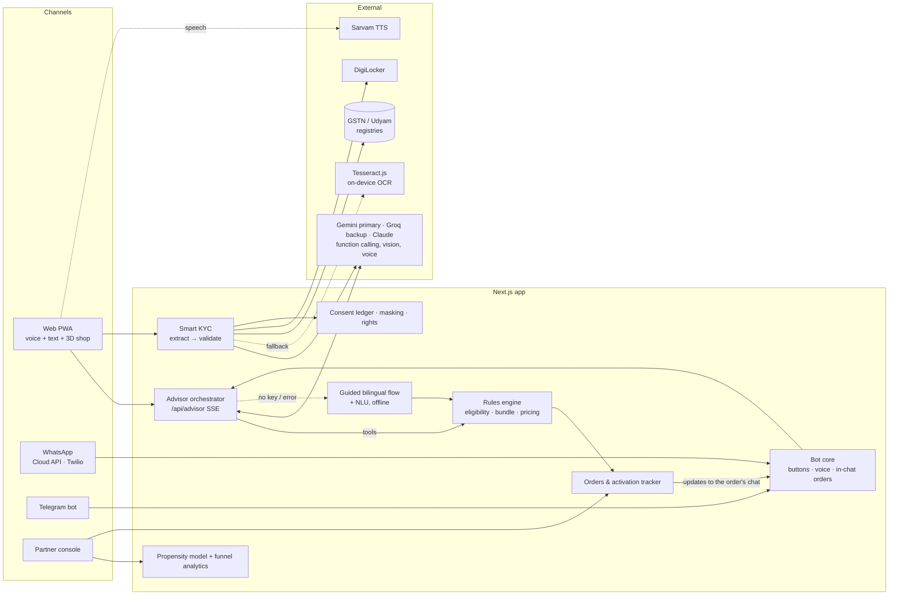
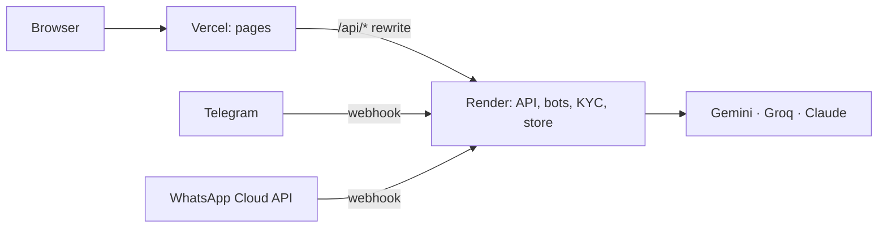

# Architecture

## Principles

1. **The LLM explains; rules decide.** The model (Gemini, or Groq/Claude as backup) collects facts (`update_profile`, `lookup_business`) and calls `recommend_bundle` / `check_product`. Products, eligibility and prices come only from the catalogue rules, so a hallucinated product or price is impossible by construction. Tool inputs are schema-validated before execution.
2. **Every AI path has a deterministic fallback.** No key, no network, exhausted credits or an API error drops the conversation into the guided bilingual flow mid-session; vision extraction falls back to Tesseract; neural TTS falls back to the browser. The demo runs fully offline.
3. **Documents verify against the source of truth**, not against each other alone: GSTIN checksum and state code, registry status and legal name, Udyam number and state, then cross-document name, address-proof age and signatory authority. Hard fails go to a human, never auto-reject. When a number is unreadable or missing, the registry is searched by business name *and* location and a suggestion is made only on a unique match; a number guessed from a blurred photo asks for a retake rather than counting as forged.
4. **Activation is staged.** Each service type has its own track and goes live when ready. Fibre infeasibility auto-swaps to 5G AirFiber with re-pricing and a WhatsApp notice.
5. **One brain, many channels.** Web, WhatsApp and Telegram call the same advisor and order code; channel adapters only translate messages in and buttons out. Order updates go to whichever chat the order came from, as one message per event with a freshly rendered status card (`cards.tsx`, `next/og`, no personal data on it).
6. **Privacy by design.** Consent per purpose before any document is read; images processed in memory and discarded (SHA-256 kept as proof); identifiers masked before they reach UI or logs.

## Key modules (`web/src/lib`)

| Module | Responsibility |
|---|---|
| `catalogue.ts`, `recommend.ts`, `pricing.ts` | Product rules, bundle selection, term/One Bill/GST pricing |
| `ai.ts`, `groq.ts`, `gemini.ts` | Provider selection (Gemini → Groq → Claude → offline), pausing on billing/quota errors (briefly for rate limits), REST + SSE clients |
| `advisor.ts`, `advisor-guided.ts`, `nlu.ts` | Gemini, Groq and Claude tool loops, offline flow, Hinglish/Devanagari slot extraction |
| `extract.ts`, `kyc.ts`, `gstin.ts`, `registry.ts` | Vision/OCR extraction, validation rules, checksum and OCR repair |
| `bots/core.ts`, `bots/telegram.ts`, `bots/whatsapp-cloud.ts`, `notify.ts`, `orders.ts` | Channel-agnostic bot, Telegram/WhatsApp adapters (buttons, lists, images, voice, signatures), order creation and update delivery |
| `cards.tsx`, `api/card/*` | Quote and order-status card PNGs for the chats (Mukta font, rendered per request) |
| `components/shop/*` | three.js shop scene: products as props, live/setting-up states |
| `tracker.ts`, `store.ts`, `db.ts` | Activation timelines; sessions/orders/consent/audit store (in-memory, written through to Neon Postgres, loaded at boot; JSON file without a database) |
| `media.ts` | Chat cards rendered once per update, uploaded to Neon Object Storage (private, 7-day signed links) and to WhatsApp media, so cards arrive with their message |
| `winback.ts`, `budget.ts`, `nudges.ts` | Growth loops: personal win-back links that pre-fill the chat from the CRM, budget fitting, one reminder per stall inside the 24-hour window, referral links |
| `analytics.ts` | Propensity scoring (trained by `scripts/train_propensity.py`) and funnel stats |
| `privacy.ts` | Purposes, masking, redaction, hashing |

## Deployment

One codebase, two deployments. The frontend holds no secrets; see [deploy.md](deploy.md).

## Production path

in-process demo clock → event-driven workflow (provisioning webhooks); mock DigiLocker/e-sign/UPI → real APIs; WhatsApp test number → verified business number with approved `order_update` templates for updates outside the 24-hour window.
