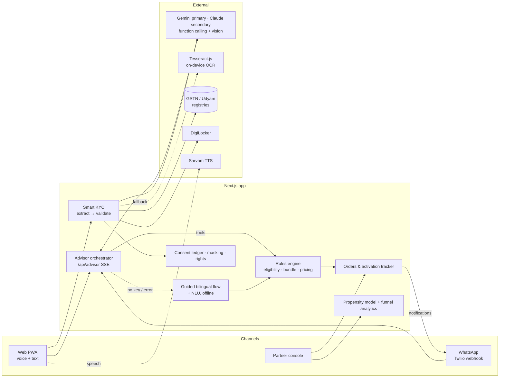

# Architecture

## Principles

1. **The LLM explains; rules decide.** The model (Gemini, or Claude) collects facts (`update_profile`, `lookup_business`) and calls `recommend_bundle` / `check_product`. Products, eligibility and prices come only from the catalogue rules, so a hallucinated product or price is impossible by construction. Tool inputs are schema-validated before execution.
2. **Every AI path has a deterministic fallback.** No key, no network, exhausted credits or an API error drops the conversation into the guided bilingual flow mid-session; vision extraction falls back to Tesseract; neural TTS falls back to the browser. The demo runs fully offline.
3. **Documents verify against the source of truth**, not against each other alone: GSTIN checksum and state code, registry status and legal name, Udyam number and state, then cross-document name, address-proof age and signatory authority. Hard fails go to a human, never auto-reject.
4. **Activation is staged.** Each service type has its own track and goes live when ready. Fibre infeasibility auto-swaps to 5G AirFiber with re-pricing and a WhatsApp notice.
5. **Privacy by design.** Consent per purpose before any document is read; images processed in memory and discarded (SHA-256 kept as proof); identifiers masked before they reach UI or logs.

## Key modules (`web/src/lib`)

| Module | Responsibility |
|---|---|
| `catalogue.ts`, `recommend.ts`, `pricing.ts` | Product rules, bundle selection, term/One Bill/GST pricing |
| `ai.ts`, `gemini.ts` | Provider selection (Gemini → Claude → offline), pausing on billing/quota errors, Gemini REST + SSE client |
| `advisor.ts`, `advisor-guided.ts`, `nlu.ts` | Gemini and Claude tool loops, offline flow, Hinglish/Devanagari slot extraction |
| `extract.ts`, `kyc.ts`, `gstin.ts`, `registry.ts` | Vision/OCR extraction, validation rules, checksum and OCR repair |
| `tracker.ts`, `store.ts` | Activation timelines, sessions/orders/consent/audit store |
| `analytics.ts` | Propensity scoring (trained by `scripts/train_propensity.py`) and funnel stats |
| `privacy.ts` | Purposes, masking, redaction, hashing |

## Production path

JSON file store → Postgres (Supabase); in-process demo clock → event-driven workflow (provisioning webhooks); mock DigiLocker/e-sign/UPI → real APIs; Twilio sandbox → WhatsApp Business API with approved templates.
