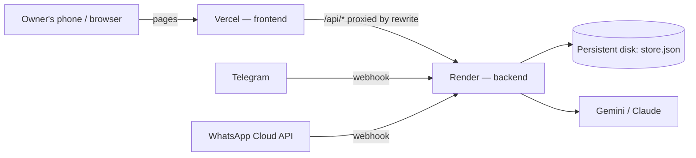

# Deploy: frontend on Vercel, backend on Render

One Next.js codebase (`web/`), deployed twice:

- **Backend (Render)** runs every `/api/*` route: advisor, quote, orders, Smart KYC, the store, and the Telegram and WhatsApp webhooks. It holds all secrets.
- **Frontend (Vercel)** serves the pages. With `BACKEND_URL` set, `next.config.ts` rewrites `/api/*` to the backend, so the browser stays same-origin (no CORS) and Vercel holds no secrets.

## 1. Backend on Render

1. Render dashboard → **New → Blueprint** → connect `perrysolid/AIRTEL-SYNC`. Render reads `render.yaml`.
2. Fill in the secret env vars it asks for (copy from `web/.env.local`):
   `GEMINI_API_KEY`, `TELEGRAM_BOT_TOKEN`, `WHATSAPP_TOKEN`, `WHATSAPP_PHONE_NUMBER_ID`, `WHATSAPP_VERIFY_TOKEN`, `WHATSAPP_APP_SECRET`, and optionally `ANTHROPIC_API_KEY`.
   Leave `PUBLIC_BASE_URL` for step 3. `TELEGRAM_WEBHOOK_SECRET` is generated.
3. Deploy. Check `https://<service>.onrender.com/api/health` shows `"ok": true`.

The blueprint uses the **Starter** plan because the order store lives on a 1 GB persistent disk (`STORE_DIR=/var/data`). On the free plan, delete the `disk` block: it works, but orders reset on every deploy or sleep, and the first request after sleep takes ~50 s.

**Telegram** needs no manual step: on boot the backend points the bot's webhook at `RENDER_EXTERNAL_URL/api/telegram`. Stop any local `npm run telegram` poller, which would otherwise remove the webhook.

## 2. Frontend on Vercel

1. Vercel → **Add New → Project** → import `perrysolid/AIRTEL-SYNC`.
2. **Root Directory:** `web`. Framework: Next.js (auto-detected).
3. Env vars:
   - `BACKEND_URL` = `https://<service>.onrender.com`
   - `NEXT_PUBLIC_TELEGRAM_BOT` = `UdyamAdvisorBot`
4. Deploy.

## 3. Connect them

- Render → `PUBLIC_BASE_URL` = your Vercel URL (e.g. `https://airtel-sync.vercel.app`), then redeploy. Links in bot messages ("See & adjust my quote", "Verify my business") open the frontend.
- Meta App Dashboard → WhatsApp → Configuration → **Callback URL** = `https://<service>.onrender.com/api/whatsapp`, **Verify token** = your `WHATSAPP_VERIFY_TOKEN`, subscribe to **messages**.
- Meta App settings → Basic → **Privacy policy URL** = `https://<vercel-url>/privacy`.

## Notes

- Before the demo, replace the 24-hour WhatsApp token with a permanent system-user token.
- To keep both on one host instead, deploy `web/` to Render alone and skip Vercel: nothing else changes.
