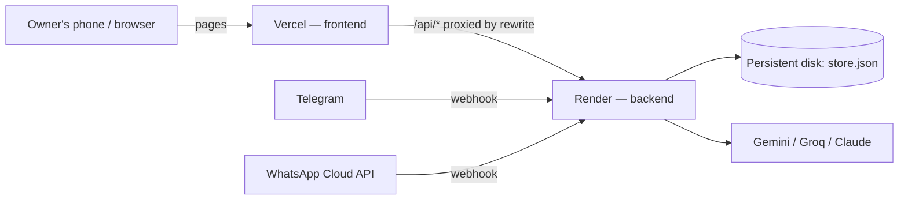

# Deploy: frontend on Vercel, backend on Render

One Next.js codebase (`web/`), deployed twice:

- **Backend (Render)** runs every `/api/*` route: advisor, quote, orders, Smart KYC, the store, and the Telegram and WhatsApp webhooks. It holds all secrets.
- **Frontend (Vercel)** serves the pages. With `BACKEND_URL` set, `next.config.ts` rewrites `/api/*` to the backend, so the browser stays same-origin (no CORS) and Vercel holds no secrets.

## 1. Backend on Render

**Free plan (New → Web Service):**

| Field | Value |
|---|---|
| Repository / branch | `perrysolid/AIRTEL-SYNC`, `main` |
| Root Directory | `web` |
| Runtime | Node |
| Build Command | `npm ci && npm run build` |
| Start Command | `npm start` |
| Instance Type | Free |
| Health Check Path | `/api/health` |

Environment variables: `NODE_VERSION=22`, `NODE_OPTIONS=--dns-result-order=ipv4first`, then copy from `web/.env.local`: `GEMINI_API_KEY`, `GROQ_API_KEY`, `TELEGRAM_BOT_TOKEN`, `TELEGRAM_WEBHOOK_SECRET`, `WHATSAPP_TOKEN`, `WHATSAPP_PHONE_NUMBER_ID`, `WHATSAPP_VERIFY_TOKEN`, `WHATSAPP_APP_SECRET`. Add `PUBLIC_BASE_URL` in step 3.

Free-plan limits: the service sleeps after 15 minutes idle (~50 s cold start; a free cron job hitting `/api/health` every 10 minutes keeps it awake), and the order store resets on every deploy or restart.

**Paid plan (New → Blueprint):** Render reads `render.yaml`, which adds a 1 GB persistent disk (`STORE_DIR=/var/data`) so orders survive deploys. Fill in the secrets it asks for.

Check `https://<service>.onrender.com/api/health` shows `"ok": true` and the providers you configured.

**Telegram** needs no manual step: on boot the backend points the bot's webhook at `RENDER_EXTERNAL_URL/api/telegram`. Stop any local `npm run telegram` poller, which would otherwise remove the webhook.

## 2. Frontend on Vercel

1. Vercel → **Add New → Project** → import `perrysolid/AIRTEL-SYNC`.
2. **Root Directory:** `web`. Framework: Next.js (auto-detected).
3. Build and Output Settings: leave every override off (Next.js preset).
4. Env vars (no API keys here):
   - `BACKEND_URL` = `https://<service>.onrender.com` (no trailing slash)
   - `NEXT_PUBLIC_TELEGRAM_BOT` = `UdyamAdvisorBot`
5. Deploy. Settings → General → Node.js Version: 22.x. `BACKEND_URL` is read at build time, so redeploy after changing it.
6. Check `https://<vercel-url>/api/health` returns the same JSON as Render's.

## 3. Connect them

- Render → `PUBLIC_BASE_URL` = your Vercel URL (e.g. `https://airtel-sync.vercel.app`), then redeploy. Links in bot messages ("See & adjust my quote", "Verify my business") open the frontend.
- Meta App Dashboard → WhatsApp → Configuration → **Callback URL** = `https://<service>.onrender.com/api/whatsapp`, **Verify token** = your `WHATSAPP_VERIFY_TOKEN`, subscribe to **messages**.
- Meta App settings → Basic → **Privacy policy URL** = `https://<vercel-url>/privacy`.

## Notes

- Before the demo, replace the 24-hour WhatsApp token with a permanent system-user token.
- To keep both on one host instead, deploy `web/` to Render alone and skip Vercel: nothing else changes.
